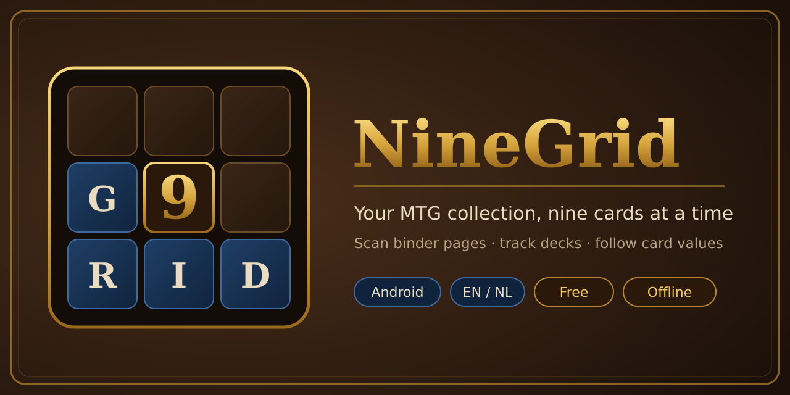

# NineGrid

Free Android app (8.0+) for your Magic: The Gathering collection and decks.
Gratis Android-app (8.0+) voor je Magic: The Gathering-collectie en decks.

- Scan a binder page of 9 cards (on-device text recognition, no photos stored or sent)
- Paste lists: `1 Edgar Markov (INR) 328`, `*F*` foil, `*E*` etched, sections Commander / Deck / Sideboard
- Collection, decks with format, legality and Commander bracket estimate
- Prices from Cardmarket (EUR) or TCGplayer (USD) via Scryfall
- Locations (binder / page / slot), change log with undo, backup and export
- English and Dutch, day and night theme

## Versions
0.x: test versions of part 1. 1.0 arrives when part 2 is done (Google Sheet sync and deck suggestions).

## Install
Download the latest `NineGrid-vX.Y.Z.apk` from [Releases](../../releases) and open it on your phone
(allow "install unknown apps" for your browser or file manager).

## Privacy
No account, no tracking, no ads. Only card names and numbers are sent to Scryfall.

## Credits
Card data and images: [Scryfall](https://scryfall.com). NineGrid is unofficial Fan Content permitted under the
Fan Content Policy. Not approved/endorsed by Wizards. Portions of the materials used are property of Wizards of
the Coast. ©Wizards of the Coast LLC.

License: MIT
